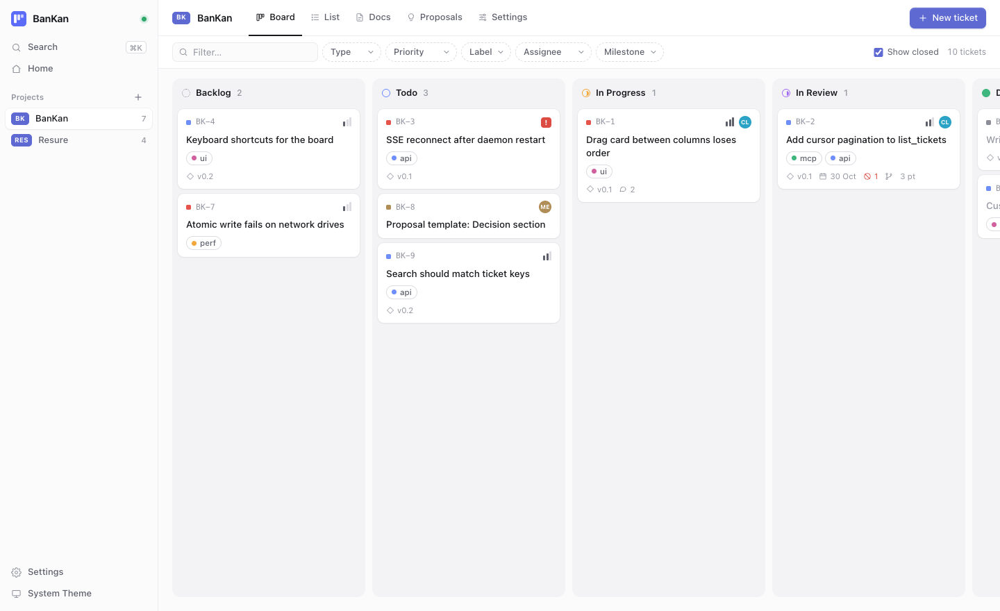

# BanKan

A local, lightweight tracker for all your projects: **Kanban tickets, docs and proposals**, with a clean web UI and an **MCP server for AI agents**.

Nothing goes into your code repos, so there are no merge conflicts from bug lists or plans. The data lives in `~/.bankan` as plain Markdown files, with optional automatic git backup.



## Features

- **Kanban boards** for each project. Drag and drop cards, use custom statuses, collapse columns, and filter by type, priority, label, assignee or milestone.
- **Tickets** with:
  - a Markdown description and comments
  - type, priority, labels, assignee, estimate, due date and milestone
  - sub-tickets, plus *blocks*, *related* and *duplicate* links
  - git branch, links to PRs and commits, and custom fields
- **Docs:** Markdown pages in folders, with a side-by-side editor.
- **Proposals:** RFC/ADR-style design documents that move from draft to review to accepted or rejected, linked to the tickets that implement them.
- **AI agents over MCP.** Claude Code, or any MCP client, can read and update tickets, docs and proposals. The output is designed to keep token use low. See [docs/AGENT-INTERFACE.md](docs/AGENT-INTERFACE.md).
- **Live updates.** When an agent moves a card, the board updates on its own.
- **One small binary** with the web UI built in. It starts at login, and the release build is about 5 MB and uses about 10 MB of RAM.
- **Plain-text storage.** Every ticket, doc and proposal is a Markdown file with YAML front matter. You can grep it, edit it and diff it.
- **Optional git backup** on a timer, with push to a private remote.
- ⌘K search, light and dark themes, keyboard friendly.

## Install

You need **Rust** 1.85 or newer ([rustup.rs](https://rustup.rs)), **Node.js** 20 or newer, and **git**.

```bash
git clone <this repo> bankan && cd bankan
make install        # builds the web UI and installs `bankan` into ~/.cargo/bin
bankan setup        # guided setup
```

`bankan setup` walks you through:

1. the port for the web UI (default `7777`)
2. backups: local git history, history plus push to a remote, or none
3. starting BanKan automatically at login (launchd on macOS, systemd on Linux)
4. connecting Claude Code, which registers the MCP server for every repo
5. linking the repo you're in to a project, creating the project if needed

Then open **http://127.0.0.1:7777**, or run `bankan open`.

> **Tip: make it feel like an app.** Open BanKan in Safari, then choose File → Add to Dock. In Chrome or Edge, install it as an app from the browser menu. It opens in its own window like a native app.

<details>
<summary>Manual setup (without the wizard)</summary>

```bash
bankan install                                       # autostart at login
claude mcp add bankan --scope user -- bankan mcp     # connect Claude Code
cd ~/code/my-repo && bankan link RES --create "My Repo"
```
</details>

## Concepts

| | |
|---|---|
| **Project** | Has a short **key** (`RES`) used in ticket ids (`RES-12`) and proposal ids (`RES-P3`). Each project has its own statuses, types, labels, milestones and custom fields. |
| **Status** | A board column. Each status belongs to a fixed **category** (`backlog`, `unstarted`, `started`, `completed` or `canceled`), so filters and agents know what's open, active or closed whatever you name the columns. |
| **Ticket** | A unit of work: bug, feature, task, chore, or your own types. |
| **Doc** | Long-lived reference material, organised in folders. |
| **Proposal** | A design that needs a decision. It starts from a template (Summary, Motivation, Proposal, Alternatives, Risks, Open questions, Decision), and accepted proposals turn into tickets. |

The reasons behind these choices are in [docs/RESEARCH.md](docs/RESEARCH.md).

## Linking repos to projects

The server doesn't store repo paths. Each **repo points at its project** with a one-line `.bankan` file:

```bash
cd ~/code/resure
bankan link RES      # writes ./.bankan (at the git root)
```

```toml
# .bankan
project = "RES"
```

The file never changes after it's written, so it can't cause merge conflicts. Commit it so the link travels with the repo, or keep it local:

```bash
echo .bankan >> ~/.config/git/ignore
```

`.bankan` may also set `url = "http://127.0.0.1:<port>"` to point the MCP server at a daemon on another port. Only localhost addresses are accepted, so a repo you clone can't redirect your agent's tool calls elsewhere.

**One project, several repos.** When a project spans repos (an app monorepo, an infra repo, a marketing site), link each with a component:

```bash
bankan link HH --component apps     # in hellohouse-apps
bankan link HH --component cloud    # in hellohouse-cloud
```

Tickets an agent creates from a repo get that repo's `component`, `context` lists that component's in-progress tickets first, and the board and list can filter and group by component.

## Using it with AI agents

Connect once (`bankan setup` does this for you):

```bash
claude mcp add bankan --scope user -- bankan mcp
```

In a linked repo, Claude Code picks up the project automatically. You can ask things like:

- "what's in progress?"
- "file a bug for the crash we just found"
- "start RES-14"
- "write a proposal for moving auth to OAuth"
- "turn RES-P3 into tickets"

**Tools:**

| Kind | Tools |
|---|---|
| Context | `context` |
| Projects | `list_projects`, `create_project` |
| Tickets | `list_tickets`, `get_ticket`, `create_ticket`, `update_ticket`, `add_comment` |
| Docs | `list_docs`, `get_doc`, `write_doc` |
| Proposals | `list_proposals`, `get_proposal`, `create_proposal`, `update_proposal` |
| Search | `search` |

Agents can't delete anything. Deletes happen in the UI.

**Slash commands in Claude Code:**

| Command | What it does |
|---|---|
| `/bankan:next` | Pick the most important open ticket and start it |
| `/bankan:wrap` | Comment, link the work and move the ticket to review |
| `/bankan:plan RES-P3` | Break a proposal into linked tickets |

**Other MCP clients:** run `bankan mcp` as a stdio server with the repo as its working directory:

```json
{ "mcpServers": { "bankan": { "command": "bankan", "args": ["mcp"] } } }
```

The full tool reference is in [docs/MCP.md](docs/MCP.md).

## Web UI

| | |
|---|---|
| ⌘K | Search everything |
| Click a card | Open the ticket panel. Fields save as you change them. |
| Double-click a description | Edit it. ⌘↵ saves, Esc cancels. |
| ⌘S | Save in the docs editor |
| Esc | Close panels and dialogs |
| Column `‹` | Collapse a column. "Canceled" starts collapsed. |

The project **Settings** tab is where you edit statuses (name, category, colour, order), types, labels, milestones and custom fields. When you rename something, the change carries over to existing tickets.

## Importing docs

`bankan import docs/` copies every `.md` file under a folder into the project's docs, keeping the folder layout (paths are lowercased and slugified: `Research Notes/AI native.md` → `research-notes/ai-native`). The title comes from front matter, else the first `# ` heading, else the file name.

Run it again whenever the source changes. Each doc remembers its source file and what was imported, so a re-run updates docs whose source changed, leaves the rest alone and never deletes anything. A doc that was edited in BanKan after the import is skipped rather than overwritten, as is a hand-made doc already at the same path; `--force` replaces both. Use `--dry-run` to see what would happen first.

Relative links between imported files (`[05](05-architecture.md#15-decision-log)`) keep working: the UI resolves them to the matching doc and section.

## CLI

```
bankan                 status at a glance (or a welcome message before setup)
bankan setup           guided setup
bankan open [KEY]      open the web UI (at the linked project's board inside a repo)
bankan link KEY        link this repo to a project   [--create "Name"] [--component apps]
bankan unlink          remove this repo's link
bankan import DIR      import a folder of Markdown as docs   [--project KEY] [--prefix path] [--dry-run] [--force]
bankan status          server, backup and link status
bankan backup          run a git backup now
bankan install         start at login (launchd / systemd)
bankan uninstall       remove autostart (keeps data)
bankan serve           run the server in the foreground
bankan mcp             MCP server over stdio (started by your AI client)
```

## Data and backups

```
~/.bankan/
  config.toml                  port and backup settings
  bankan.log                   server log (when installed as a service)
  data/                        ← everything; a git repo when backups are on
    projects/RES/
      project.yaml             statuses, types, labels, milestones, fields
      tickets/RES-12.md        YAML front matter + Markdown description
      proposals/RES-P3.md
      docs/guides/setup.md
```

The format is documented in [docs/DATA-FORMAT.md](docs/DATA-FORMAT.md).

**Backups:** when they're on, BanKan commits `data/` every N minutes if anything changed, and again when it shuts down. With a remote set, it also pushes, first merging anything another machine pushed to the same remote (restart the server to load a project that arrives this way). If both machines changed the same file, the backup reports it and leaves the merge to you. It uses your normal git credentials (SSH agent or credential helper). You can change the settings in the UI under **Settings → Backup**, or in `config.toml`:

```toml
port = 7777

[backup]
enabled = true
interval_minutes = 15
remote = "git@github.com:you/bankan-data.git"   # optional
branch = "main"
```

**Editing files by hand:** the server loads everything into memory when it starts. To edit files directly (or after a `git pull` in `data/`), stop the server first, or restart it afterwards:

```bash
launchctl kickstart -k gui/$(id -u)/dev.bankan.daemon    # macOS
systemctl --user restart bankan                         # Linux
```

**Environment variables:**

| Variable | Effect |
|---|---|
| `BANKAN_HOME` | Use a different home folder instead of `~/.bankan` |
| `BANKAN_URL` | Point `bankan mcp` at a different server |
| `BANKAN_AGENT` | Set the name the agent uses as assignee and comment author (default `claude` for Claude Code) |

## Security

The server listens on `127.0.0.1` only. It rejects requests whose `Host` isn't localhost, which blocks DNS rebinding. It also rejects browser requests whose `Origin` isn't a localhost page, so other websites can't call the API. Links stored on tickets must be `http(s)` or `mailto`, and the UI won't turn anything else into a clickable link, so a `javascript:` URL written by an agent or a hand edit can't run in the UI. The `url` override in a repo's `.bankan` must be a localhost address. There are no accounts, because BanKan is a single-user tool for your own machine.

## Development

```bash
make dev     # server on :7777 plus the Vite dev server with hot reload on :5173
make test    # Rust unit tests + TypeScript type-check
make build   # release binary at target/release/bankan
```

```
src/
  main.rs      CLI entry point (clap)
  cli.rs       setup wizard and styled terminal output
  server.rs    axum HTTP server: REST API, SSE, embedded UI, backup loop
  store.rs     in-memory store backed by Markdown files
  model.rs     data types
  mcp.rs       stdio MCP server (forwards to the HTTP API)
  backup.rs    git backup
  service.rs   launchd / systemd install
  link.rs      .bankan file lookup
web/           React + Vite + TypeScript UI (embedded into the binary at build time)
docs/          plan, research, data format, MCP reference
```

For the design and its trade-offs, see [docs/PLAN.md](docs/PLAN.md).

## Uninstall

```bash
bankan uninstall                       # stop and remove autostart
claude mcp remove bankan --scope user
cargo uninstall bankan
rm -rf ~/.bankan                       # only if you want to delete your data
```
